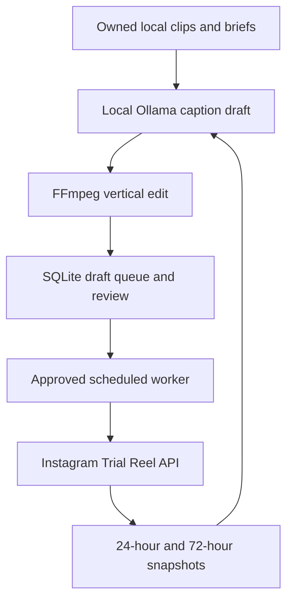

# Reel Lab

Local-first manager for Instagram Trial Reels. Designed for low-VRAM PCs such as a dual GTX 950 desktop. No paid social scheduler or cloud LLM required. Python controls scheduling and publishing; a small local Ollama model writes captions and suggests experiments. Only approved, genuine video content is published, and dry-run mode is the default.

## Quick start

Install Python 3.10+, FFmpeg (including ffprobe) and optionally Ollama. From this directory:

```powershell
py -3 -m venv .venv
.\.venv\Scripts\python.exe -m pip install -e .
Copy-Item .env.example .env
ollama pull qwen3:1.7b
.\.venv\Scripts\python.exe -m reel_lab doctor
```

See [INSTALL.md](INSTALL.md) for Windows/Linux, GPU settings, Meta setup, local upload, dry runs, unattended operation and troubleshooting. No Instagram token is needed for dry runs. For a graphical review screen install `requirements-dashboard.txt` and start Streamlit locally.

## Architecture



* `add` renders one clip and drafts a caption; `ingest` prepares a folder of clips with matching text briefs. The model receives descriptions and prior metric samples, not raw video or account credentials.
* `edit`, `approve`, `cancel` and `reset-dry` manage drafts. A draft approved in dry-run mode cannot become a live post merely by switching a flag.
* `tick` runs one scheduling cycle; `worker` repeats it. An atomic SQLite claim, rolling daily cap and spacing rule limit attempts. Exact rendered duplicates are rejected. This is not perceptual duplicate detection.
* `report --ai` asks the local model to interpret available metric samples and propose further experiments. It does not automatically repost videos or publish suggestions.
* `dashboard.py` is an optional localhost-only review interface. Keep the command-line worker running separately.
* `profile-import`, `generate`, and `generate-worker` implement the first four automatic reel generation phases: account profiles, footage analysis, AI edit plans, and multi-clip rendering. Start with [GENERATION.md](GENERATION.md). Existing vision-tagged footage remains compatible.
* Phase 5 adds official Instagram music discovery, outdoor Reel reference research, local licensed audio registration, AI soundtrack selection, local mixing and beat-aligned cuts, and same-age music analytics. See [AUDIO.md](AUDIO.md). Native music is opt-in; existing profiles keep music off until configured.

## Status and limitations

The Instagram adapter uses the container-create/upload/status/publish pattern. Trial request fields and resumable upload compatibility depend on the account, API version and login type. Live publication is an integration to validate with one authorized Trial Reel; no normal-Reel fallback is implemented. The current test suite mocks external API responses and cannot establish actual account eligibility or API acceptance. There is no browser automation, credential scraping, auto-following, unsolicited messaging, or engagement manipulation.

This version creates vertical clips from provided footage, not AI-generated video. It analyzes sampled frames and optional speech transcripts, not every frame. It doesn't automatically create synchronized subtitles, generate imagery, or promote trials itself; use Instagram's own automatic promotion setting if desired. Local licensed music supports full preview; native Instagram music is added on publication and cannot be previewed locally. Human approval is required for each live draft. The local model can suggest but cannot execute arbitrary tools or commands.

## Test

```sh
python -m unittest discover -s tests -v
```

The CI workflow tests Python 3.10 and 3.12 on Windows and Linux. Local operational data and secrets are excluded from Git.
